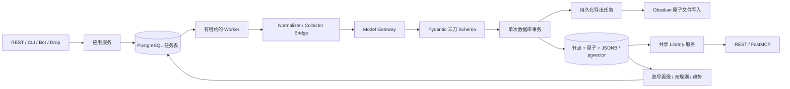

# 底层架构与约束

## 分层

`domain` 定义可替换边界，`ingestion` 只负责素材标准化，`models` 只负责厂商传输和结构化推理，`services` 负责业务事务。REST 和 MCP 调用同一个 Library，避免两套检索逻辑漂移。

## 任务语义

状态机：`queued → running → succeeded`；临时失败进入 `retrying`，耗尽次数或配置错误进入 `failed`。手动重试只接受 `failed`。

PostgreSQL 使用 `FOR UPDATE SKIP LOCKED` 和条件更新领取任务；每次领取生成新的租约 token。Worker 心跳延期；提交结果时再次检查 token、状态和到期时间，过期 Worker 不能写回。进程在执行中退出，其他 Worker 可在租约过期后接管。高优先级任务优先，同级 FIFO。

投喂、Bot update、巡检周期、巡检内容、阈值进化、反馈事件均有持久化幂等键。相同幂等键与不同请求体会返回 409。投喂的 `priority` 不参与内容身份；重投同一内容不会通过改变优先级生成第二份卡片。重新解剖可使用新的 Idempotency-Key 或不同 instruction。

重试退避 30/60/120 秒，最高 300 秒；配置、认证错误不无限重试。模型网关设 1 秒连接超时、60 秒默认请求超时、30 秒失败熔断窗口。PRD 的“1 秒切换”只对连接失败有相近目标，不能保证所有模型请求在 1 秒内发现故障。

SQLite 用于单进程演示和可移植测试，不作为多 Worker 生产数据库。

## 双写一致性

节点、原子和 `export_node` 任务在同一事务提交。导出任务相当于事务 outbox，单独消费并重试。用内容 ID 命名文件；同目录临时文件 `fsync + os.replace`，重试覆盖同一目标，不产生重复卡片。

这是**最终一致性**。数据库与文件系统无法共享一个原子事务。进程在文件落盘后、数据库确认前崩溃时，会重新写同一文件；数据库成功、文件失败时可查到 pending 状态和导出任务错误。原始媒体使用 SHA-256 内容寻址，CLI 在入队前保存快照。

数据库是事实来源；Vault 是可重建的导出视图。用户在 Vault 中的手工修改暂不反向同步数据库。Syncthing 只同步 Vault/媒体文件，不同步运行中的数据库目录，也不提供多机数据库冲突合并。

## 模型边界与证据

三刀分别使用 `StrategyAnalysis`、`VisualAnalysis`、`VideoAnalysis`；跨界 DNA 必填，禁止额外未声明字段，分镜区间必须按时间顺序且不重叠。数值未知可为 null。

色卡由 colorgram 从真实像素计算，模型生成后由管道覆盖色值和占比。60/30/10 是设计描述，不强制修改真实测量值。视频必须传原生视频，不以文字材料替代。记录 schema 版本、模型、延迟、失败回退、输入限制与 demo 标记。

动态模型发现和能力授权分开：`models sync` 更新可见 ID，路由文件决定哪些模型能处理哪种模态。发现新 ID 不会自动加入生产路由。每次调用重读 YAML，可热切换。健康探针验证的是一次文本生成，不冒充所有模态的能力验收。

## 检索与进化

标签匹配 PostgreSQL JSONB GIN；语义检索用 1536 维 pgvector、HNSW cosine 索引，并限制同一个 embedding 模型空间。未配置 embedding 时使用显式标注的关键词匹配，向量不会被零数组伪造。向量生成独立排队，失败不会回滚知识卡片。

账号每累计 5 张卡片生成画像；每标签每累计 20 张卡片蒸馏元规则。大样本按 10 张一组 Map，再 Reduce；单次最多取最新 200 张并记录采样范围。引用必须属于输入节点。画像按来源数量防止较旧生成覆盖较新结果。

趋势按平台内互动率取 Top 10%，缺失互动率的数据不参加排名。查询同时比较前后等长窗口的标签占比；没有基线时不生成虚假的增长率。趋势优先使用原平台发布时间，缺失时回退入库时间，并输出前后等长窗口的标签占比比较；统计来自已采集样本，不能等同于原平台全量趋势。

反馈用唯一 event_id 去重，原子与节点权重同事务增减。非 evergreen 且创建和最近调用均已超过 180 天的元件每周降权一次。分类树每周及累计达到阈值时自动更新。模型提出同义标签分组，服务端验证别名真实存在、来源引用合法且达到最小来源数；再以事务更新分类/别名/节点关系并保留变更日志。合并后的旧分类保留重定向，原始分析标签不改写。分类合并与新卡片挂接共享数据库锁，防止并发时遗失分类关系。

## 部署决策

主服务、Worker、调度器、Drop 监听运行在宿主机；PostgreSQL 容器化。队列采用数据库事务队列，而非同时维护 Redis 队列和数据库 outbox，从底层减少双状态一致性问题。Compose 预留 Redis `cache` profile，当前正确性不依赖 Redis。

路径使用 pathlib；无 shell 拼接下载命令。默认只监听 loopback，开放网络必须配置 Bearer token。远程源逐跳校验公网地址，连接固定到解析出的 IP，保留 Host 和 TLS SNI，避免 DNS 重绑定和重定向访问内网。源抓取不读取环境代理；需要代理或登录的平台通过受信任的 Collector 接入。

## v0.2 扩展

原生采集器、Bot、MinerU 与媒体转换均通过原有持久化任务提交结果。已解析的 RSS 正文快照随内容任务一起保存，避免再次访问登录墙后丢失正文。微信/视频号支持 WorkBuddy 目录与清单导入。

视频保留原片，生成 720p 副本、音轨和带原片偏移的分段。分段解剖必须在片段时长内，合并后重新验证绝对时间轴。Gemini 大文件走 Files API；Qwen/豆包使用 video_url。无音频能力的路由不会保留未验证的语音/BGM 字段。音频转写按片段执行并缓存。

新增迁移 0002_taxonomy，兼容现有数据；新增原始发布时间、分类、别名和节点关联表。默认不自动接管操作系统登录或网络账户，部署脚本由管理员在配置后运行。
